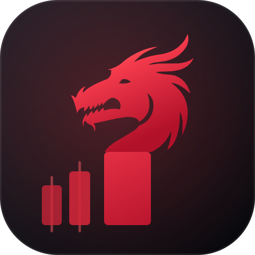

<div align="center">



# 龙头战法 · Dragon Head Tactics

**A 股短线交易体系的 Agent Skill** —— 情绪周期择时、八大分歧买点、游资席位实证、唯一最高标回测。

一个 `SKILL.md` + 三个 Python 脚本，装进任何会读文件、会跑命令的 AI Agent 里，
它回答「龙头是谁 / 现在能不能打板 / 这只票游资怎么看 / 帮我回测一下」时，会先跑数据再给条件，而不是背诵话术。


[](LICENSE)
[](https://www.python.org/)
[](https://tushare.pro/)

</div>

> ⚠️ 本项目是研究框架与复盘工具，**不构成投资建议**。游资手法是概率与择时体系，不是可机械复制的买入信号。

---

## 这是什么

A 股「龙头战法」的完整作业手册，把赵老哥、章盟主、炒股养家、陈小群、作手新一、佛山系、欢乐海岸、
一瞬流光（光神）等游资的公开体系，整理成**可判定的规则**，再用 Tushare 的真实席位数据做检验：

- **共识层**：只做龙头 / 买在分歧卖在一致 / 情绪定仓位 / 只做主升 / 模式单一 / 错了就走。
- **择时**：情绪周期六阶段（冰点 → 启动 → 发酵 → 高潮 → 分歧 → 退潮），每档给量化信号与仓位；
  另有五个温度计的阈值、冰点三特征、退潮提前信号顺序，以及按本机近 20 交易日分位数校准阈值的方法。
- **身份判定**：同一个「涨得最猛」有两种角色 —— **板块龙（主线容量龙）** 与 **情绪龙（高标妖股）**。
  行业广度、题材标签、换手率、估值对两者的含义不同，用错尺子会把全场辨识度最高的那只判成杂毛跟风股。
- **买点**：八大分歧买点（二板分歧转一致、烂板弱转强、分歧回封、首阴反包、分歧低吸、龙头分离、N 型反包、妖股二波）+ 两个窄场景（三点共振、转势板）。
- **实证**：`hm_list ∩ top_inst` 席位口径，算出每个游资真实的上榜日、买在涨停日的比例、次日表现、板位分布。
- **回测**：「只买市场唯一最高标」的逐笔回测，含五种卖法敏感性、一字板门槛、未来函数偏差折算。
- **输出结构**：给定一只票时的固定六段式点评；手里有持仓时「先处置、再谈新标的」的处理路径。

## 能接哪些 AI

`SKILL.md` 就是带 YAML frontmatter 的 Markdown，脚本只依赖 `python3 + tushare + pandas`，不绑定任何厂商的私有格式。

| Agent | 装到哪 | 一句话接入 |
|---|---|---|
| **Hermes Agent** | `~/.hermes/skills/research/` | 原生技能目录，放进去即被索引 |
| **Claude Code** | `~/.claude/skills/` | 原生 Agent Skill 目录，`/skills` 可见 |
| **Codex CLI / ChatGPT** | 项目根 `AGENTS.md` 里引用 | 「涉及 A 股短线时先读 `SKILL.md` 并照做」 |
| **Gemini CLI** | 项目根 `GEMINI.md` 里引用 | 同上 |
| **Cursor** | `.cursor/rules/dragon-head.mdc` | 规则文件指向 `SKILL.md` |
| **GitHub Copilot** | `.github/copilot-instructions.md` | 同上 |
| **其他**（OpenCode / Cline / Windsurf / 自建 Agent） | 任意位置 | 能读文件 + 能跑 shell 就能用 |

```bash
git clone https://github.com/sysean/dragon-head-tactics.git
cd dragon-head-tactics

# Hermes
cp -r . ~/.hermes/skills/research/yz-dragon-head-tactics
# Claude Code
mkdir -p ~/.claude/skills && cp -r . ~/.claude/skills/yz-dragon-head-tactics
```

接进其他 Agent，把下面这段贴进 `AGENTS.md` / `GEMINI.md` / Cursor 规则即可：

```markdown
## 龙头战法
遇到 A 股短线、龙头、打板、游资、涨停复盘相关问题时，先读 `dragon-head-tactics/SKILL.md`，
按其「先跑脚本拿数据、再按固定结构输出」的要求作答；数据源一律 Tushare Pro，输出必须带免责声明。
```

## 快速开始

```bash
python3 -m venv .venv && source .venv/bin/activate
pip install -r requirements.txt

export TUSHARE_TOKEN=你的token        # https://tushare.pro/register
```

```bash
# 1) 全游资席位画像：上榜日 / 买在涨停日 / 次日表现 / 板位分布
python3 scripts/query_hot_money_roster_profile.py --start 20260401 --end 20261016

# 2) 单游资画像（默认一瞬流光）
python3 scripts/query_hot_money_seat_profile.py --name 一瞬流光 --months 6

# 3) 唯一最高标打板回测：五种卖法 + 逐笔明细
python3 scripts/backtest_unique_top_board.py --start 20260701 --end 20261020 --trades
```

结果会缓存在 `~/.hermes/cache/`（可按需改成任意目录），重复区间几乎秒出。

## 目录

```
.
├── SKILL.md                     # 主技能文件（13 节 + Pitfalls）
├── references/
│   ├── roster.md                # 游资名录、语录、心法、接力口诀
│   ├── roster-profile.md        # 批量实证原始表与逐条解读
│   ├── seats-verified.md        # 席位核对结果
│   ├── yu-lu.md                 # 语录汇编
│   ├── sentiment-cycle-quant.md # 情绪周期量化阈值、情绪龙判法、二波与禁区
│   ├── board-types-volume.md    # 板型清单、三派量能标准、一进二量能定档与实测
│   ├── cycle-crossing-screen.md # 「周期穿越」全市场扫描的口径与四类定性
│   ├── unique-top-board-backtest.md   # 回测口径、逐笔与记账坑
│   └── after-hours-selection.md # 盘后定标的的算法与代码配方（含 4.5 身份判定）
├── scripts/
│   ├── query_hot_money_roster_profile.py   # 多游资批量画像
│   ├── query_hot_money_seat_profile.py     # 单游资画像
│   ├── backtest_unique_top_board.py        # 唯一最高标回测
│   ├── calibrate_board_volume.py           # 一进二量能分档校准（含一字板剔除）
│   ├── first_board_auction.py              # 首板战法：9:25 竞价选股与回测
│   ├── dragon_market_view.py               # 盘面全景：指数/涨跌/晋级率/梯队/广度
│   ├── screen_cycle_crossing.py            # 「穿越龙」全市场扫描
│   └── intraday_rescan.py                  # 盘中复核：9:25 结论是否需要改
├── assets/                      # logo、AI 接入条、社交预览图
└── requirements.txt
```

## 数据口径（重要）

- 数据源一律 **Tushare Pro**：`hm_list`（游资名录）、`top_inst`（席位明细）、`limit_list_d`（涨停池）、`daily`、`stk_limit`。
- **席位 = 该营业部的合计成交**，一个营业部可承载多个账户；游资大量操作不触发上榜条件。
  结论只能写「上榜口径可见的部分」。
- 媒体流传的席位表普遍过时：`中国银河证券绍兴` 现属流沙河，不是赵老哥；章盟主的「浙商杭州五星路」不在 `hm_list` 里。**以 `hm_list` 为准。**
- 涨跌停阈值分板块：主板 10%、创业板/科创板 20%、北交所 30%。
- 龙虎榜是盘后数据（约 18:00 后）；盘中查不到席位 ≠ 没参与。

更多字段与坑见 `SKILL.md` 的 Pitfalls 与 `references/`。

## 许可

代码与文档：MIT。
`assets/logo.svg` 中的龙首剪影基于 [freesvg.org](https://freesvg.org/dragon-head) 的 CC0 公共领域素材（SVG ID 120574）重新构图，其余图形为原创。
文中出现的 Claude、OpenAI、Gemini、Cursor、GitHub Copilot 等名称与图形是各自公司的商标，此处仅用于说明兼容性。

<div align="center"><sub>买在分歧，卖在一致。</sub></div>
